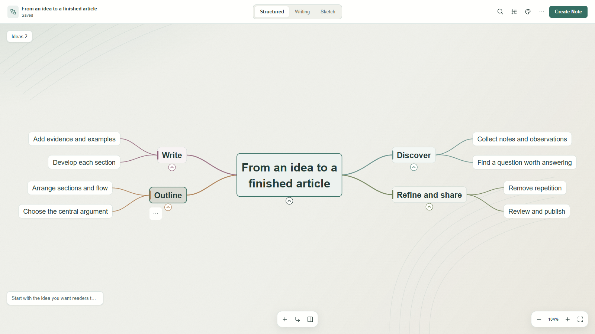
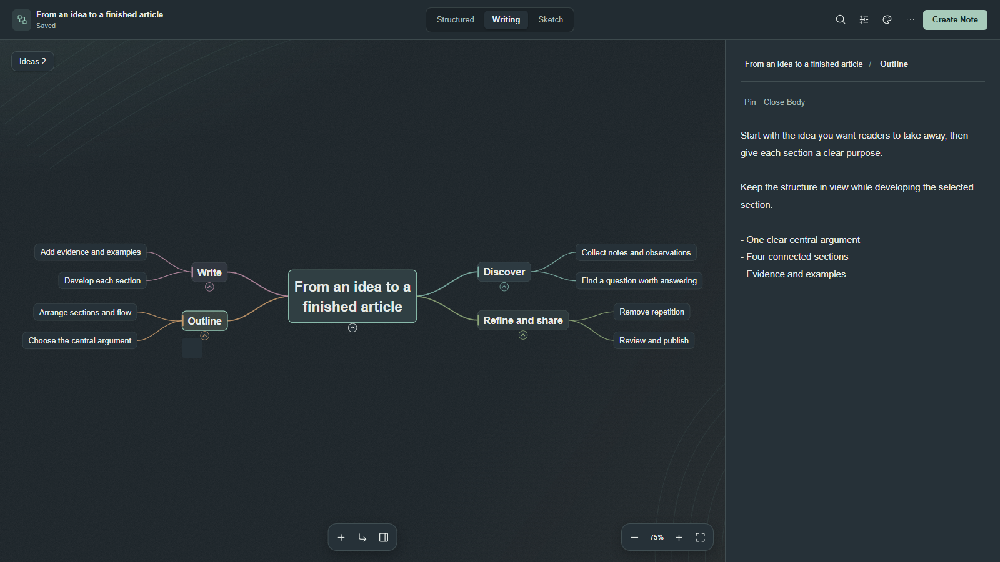

<div align="center">

# Canvas Mind Map

### See the structure. Develop the idea. Finish the note.

Turn notes into navigable mind maps, write beside your outline, or start with a blank canvas—all inside Obsidian.

**English** · [简体中文](README.zh-CN.md)

[Install in Obsidian](https://obsidian.md/plugins?id=canvas-mind-map) · [Download](https://github.com/Zenolzx/Canvas-Mind-Map/releases) · [User guide](docs/user-guide.en.md) · [Report an issue](https://github.com/Zenolzx/Canvas-Mind-Map/issues)



</div>

Canvas Mind Map connects three parts of working with ideas: **understanding what you already have, arranging what comes next, and writing the result**. Explore an existing document in Organic, build a new one in Composer, or work with ordinary cards in Native Canvas.

This README describes **1.2.0**. See the [release notes](docs/release-1.2.0.md) for changes from 1.1.1.

## A workspace for the whole idea

- **Read the shape of a document.** Turn headings into branches, fold detail away, search hidden sections, and focus on one part at a time.
- **Write with the outline in view.** Select a section, develop its body beside the map, and move whole chapters with their content.
- **Start before you know the structure.** Capture ideas in an Inbox, organize them into branches, then create a Markdown note.
- **Think beyond the outline.** Composer's free canvas adds movable notes, relationships and annotations alongside your structured draft.
- **Choose a surface that suits the work.** Coordinated light and dark palettes, paper texture, dots and grids keep the canvas and controls visually consistent.
- **Stay in your vault.** Source files remain in the vault; Composer drafts and view preferences are stored in plugin data.

## Three ways to work

| Start with… | Choose | What is saved |
| --- | --- | --- |
| An existing Markdown, DOCX or PDF document | **Organic**: explore a map, read sections, or edit supported sources | Edits write to the source; PDF stays read-only |
| A new idea, outline or article | **Composer**: collect, arrange, write, then **Create Note** | An autosaved plugin draft until you create a `.md` file |
| A native Obsidian Canvas | **Native Canvas**: generate a map from a file or text card | Ordinary nodes and edges in the `.canvas` file |

### Organic — understand and develop an existing document

Open a supported file as a mind map. Search headings even inside folded branches, focus on a subtree, or follow the document in reading order. Use Radial, Horizontal or Compact layouts; export the visible map as SVG or PNG.

Switch to **Edit** to work on Markdown or supported DOCX sections. The map holds the structure while the side editor holds the selected section's direct body. Rename headings, add siblings and children, or drag a whole section to a new place.

### Composer — from scattered ideas to a finished note

Create a blank draft or start from a writing template. Add branches with Enter and Tab, keep unplaced ideas in the Inbox, and drag them into the outline when ready. Search titles and bodies, group branches, add Todo nodes, and undo structural changes.

Move between **Structured**, **Writing** and **Sketch**. Free canvas supports saved positions, independent notes, connections and annotations. When the document is ready, **Create Note** previews the output and creates a Markdown file in your chosen folder, then opens it in Organic Edit.



*The screenshots use sample content and the current plugin components. Capture details and replacement shots are documented in the [screenshot brief](docs/screenshots.zh-CN.md).*

### Native Canvas — keep your cards and connections

Generate a collapsible map from a Markdown, DOCX, PDF or heading-based text card. Choose title-only or body content, then arrange the result using seven directional layouts. Focus branches, search headings, customize cards by level, and refresh from the source.

The result remains native Canvas data: edit cards, add outside connections, save and use Canvas undo. Cards remain in the file when the plugin is disabled; plugin folding and navigation controls require the plugin.

## Get started

### Install

In Obsidian, open **Settings → Community plugins → Browse**, search for **Canvas Mind Map**, then install and enable it. Requires **Obsidian 1.7.7 or later** according to the manifest; current desktop coexistence testing is documented separately. This release has not been validated on mobile.

For manual installation, download **`main.js`**, **`manifest.json`** and **`styles.css`** from the same [GitHub Release](https://github.com/Zenolzx/Canvas-Mind-Map/releases). Put all three in:

```text
YourVault/.obsidian/plugins/canvas-mind-map/
```

Reload Obsidian and enable the plugin. GitHub's automatic **Source code** archives are not installable plugin packages.

### Open your first map

1. **Existing document:** right-click a `.md`, `.docx` or `.pdf` file → **Open note in Organic mode**. Choose View to explore or Edit to write to a supported source.
2. **New document:** run **New Mind Map Document** from the command palette or ribbon. Name the draft, add branches, write, then choose **Create Note**.
3. **Native Canvas:** select a supported file card or a text card containing headings → right-click → **Generate collapsible mind map**.

### A few useful shortcuts

These apply while the Composer map has focus. Organic editing has a few different confirmation behaviours; see the [full guide](docs/user-guide.en.md).

| Key / gesture | Composer action |
| --- | --- |
| Enter / Tab, with a node selected | Add a sibling / child |
| F2 / double-click | Rename a node |
| Ctrl/Cmd+Enter | Open the selected node's body editor |
| Ctrl/Cmd+F | Search the draft |
| Ctrl/Cmd+Z / Ctrl/Cmd+Shift+Z | Undo / redo |
| Drag background / scroll | Pan / zoom |
| `0` | Fit the map |

## Make it yours

New installations start with **Mineral Paper** and a **paper** surface. Choose Forest mist, Terracotta, Muted lavender, Midnight Graphite or Follow Obsidian; color presets and surface materials can be changed independently. Existing saved preferences are retained.

Use stable branch colors or a single preset ink, switch heading typography, or select an image from your vault as the background. The appearance picker previews changes and restores the previous look when cancelled. English and Simplified Chinese interfaces are available in plugin settings.

## Formats, saving and boundaries

| Format / workflow | Supported | Boundary |
| --- | --- | --- |
| Markdown | Read, map, edit headings and section bodies | Heading renames do not automatically update links in other notes |
| DOCX | Map heading styles / outline levels; edit supported headings and plain-text bodies | Bodies with tables, images, fields, tracked changes or rich formatting are read-only; moving a chapter preserves its Word blocks |
| PDF | Map bookmarks and read selectable page text | Read-only; without bookmarks there is one document node; no OCR or legacy `.doc` support |
| Composer | Autosaved drafts; create Markdown with explicit export choices | “Draft saved” does not mean a Markdown file exists; free-canvas objects stay in the draft |

Composer drafts retained after note creation do not receive later edits from the created note. Undo history belongs to the editing session. External source changes are checked before writing; conflicts and unsupported sections are explained in the [writing guide](docs/mind-map-writing-mode.md).

### Enhanced Canvas compatibility

Enhanced Canvas is optional. Coexistence was tested with the **official 1.0.33 source build**, in both plugin loading orders, including folding, save/reopen, ordinary file-card property sync and independent unloading.

The **local 1.0.29 modification with an early mind-map engine** also has an explicit migration action. It preserves node IDs, content, geometry and folds, supports Canvas undo, and avoids duplicate ownership. This local modification is distinct from the official release. Title maps use text cards, so their edges do not participate in Enhanced Canvas's file-card property sync. See [tested scope and limitations](docs/enhanced-canvas-compatibility.md).

## Documentation and development

- [Complete user guide](docs/user-guide.en.md): workflows, shortcuts, export options, drafts and recovery.
- [Writing mode](docs/mind-map-writing-mode.md): section editing, source changes and conflict handling.
- [1.2.0 release notes](docs/release-1.2.0.md) · [Release procedure](docs/releasing.zh-CN.md).

To build from source with Node.js and npm:

```sh
npm ci
npm run build
```

The build creates `main.js`; install it with `manifest.json` and `styles.css`. Use `npm run dev` for watch mode. `npm test` runs model and browser regressions; `npm run lint` checks source conventions. Browser checks require an available Chromium installation; set `CMM_REQUIRE_BROWSER=1` to fail rather than skip when it is missing.

## Feedback

[Open an issue](https://github.com/Zenolzx/Canvas-Mind-Map/issues) with your Obsidian and plugin versions, workspace and mode, reproduction steps, and a small shareable source file if possible. Screenshots help explain layout problems; remove private content first.

## Acknowledgements and license

Early development migrated a limited set of Canvas interface integration implementations from [Enhanced Canvas](https://github.com/RobertttBS/obsidian-enhanced-canvas). This credit concerns those early integration implementations. The current mind-map model, layouts, Organic and Composer workspaces, document editing and visual design are developed and maintained in this project.

[MIT License](LICENSE). Original copyright notices for reused code are retained alongside this project's contributor notice.
