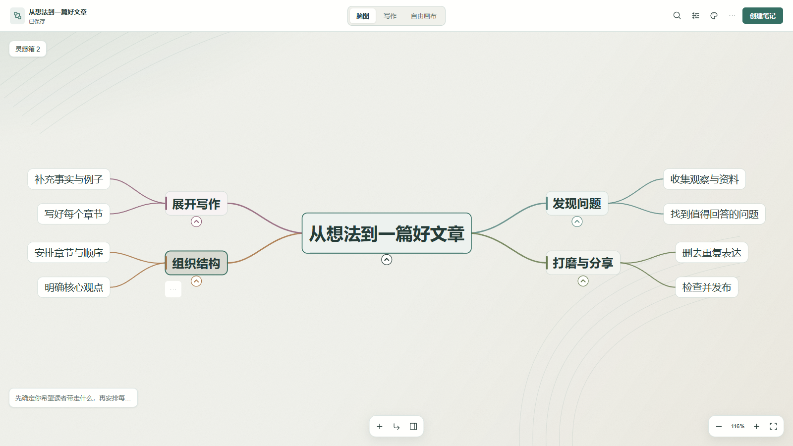
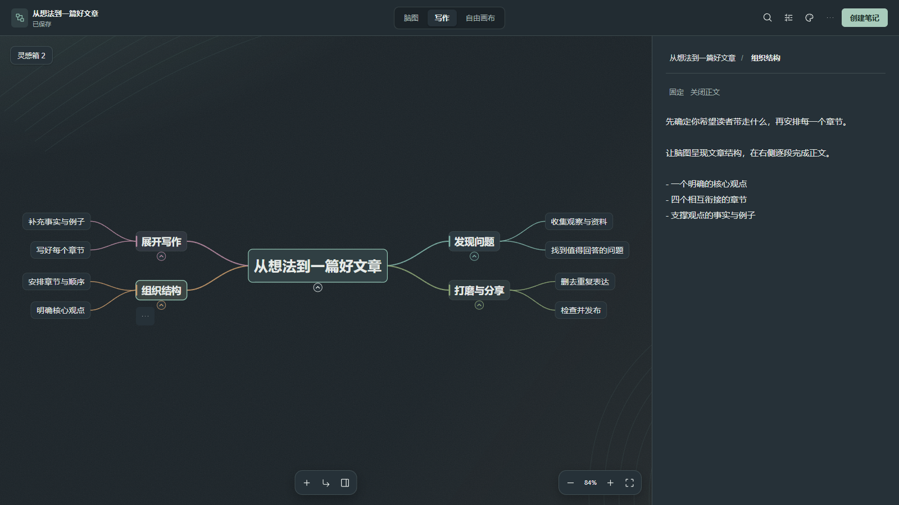

<div align="center">

# Canvas Mind Map

### 看清结构，展开想法，写成一篇笔记。

把已有笔记变成可探索的脑图，在大纲旁完成写作，或从一张空白画布开始——都在 Obsidian 中完成。

[English](README.md) · **简体中文**

[在 Obsidian 中安装](https://obsidian.md/plugins?id=canvas-mind-map) · [下载版本](https://github.com/Zenolzx/Canvas-Mind-Map/releases) · [使用手册](docs/user-guide.zh-CN.md) · [反馈问题](https://github.com/Zenolzx/Canvas-Mind-Map/issues)



</div>

Canvas Mind Map 把**理解资料、组织想法、完成写作**连接起来。用 Organic 阅读和编辑已有文档，用 Composer 从零构思一篇新笔记，也可以在 Native Canvas 中继续使用原生卡片和连线。

本页介绍 **1.2.0**。相较 1.1.1 的更新见[版本说明](docs/release-1.2.0.md)。

## 让一个想法自然展开

- **先看清全貌。** 从标题生成分支，收起细节，搜索折叠章节，聚焦眼前需要处理的部分。
- **一边组织，一边写。** 在脑图中选择章节，在旁边展开正文；调整结构时，整个章节及其内容一起移动。
- **还没想清楚，也可以开始。** 把零散想法留在灵感箱，逐步组织成大纲，准备好后再创建 Markdown 笔记。
- **给结构之外的思考留空间。** 自由画布支持便签、关联和批注，与结构化草稿一起保存。
- **选择适合工作的画面。** 协调的亮暗配色、纸纹、点阵和方格，让画布、节点与操作区保持一致。
- **资料留在仓库中。** 原文保留在 Vault，Composer 草稿与视图偏好保存在插件数据中。

## 三种开始方式

| 你手上有什么 | 选择什么 | 内容保存在哪里 |
| --- | --- | --- |
| 已有 Markdown、DOCX 或 PDF 文档 | **Organic**：浏览结构、阅读章节，或编辑受支持的原文 | 修改写回原文件；PDF 始终只读 |
| 一个新想法、一份大纲或一篇待写文章 | **Composer**：收集、组织、写作，再创建笔记 | 创建 `.md` 之前是自动保存的插件草稿 |
| 一张原生 Obsidian Canvas | **Native Canvas**：从文件或文本卡片生成脑图 | 普通节点与连线保存在 `.canvas` 文件中 |

### Organic：理解并继续完善已有文档

将受支持的文件作为脑图打开。搜索折叠分支中的标题，聚焦一个子树，或按原文顺序逐章阅读。可切换放射、水平和紧凑布局，并把当前可见结构导出为 SVG 或 PNG。

切换到**编辑**，即可修改 Markdown 或受支持的 DOCX 章节。左侧保留文章结构，右侧编辑所选章节的直属正文。修改标题、添加同级或子章节，也可以拖动整个章节调整顺序。

### Composer：从零散灵感到一篇笔记

从空白草稿或写作模板开始。用 Enter 和 Tab 添加分支，把尚未归类的想法放进灵感箱，准备好后拖入大纲。支持搜索标题与正文、分组、待办节点，以及结构修改的撤销与重做。

在**脑图、写作、自由画布**之间切换。自由画布可保存手动位置、独立便签、关联与批注。完成后，点击**创建笔记**，预览内容并选择文件夹，生成 Markdown 文件，随后进入 Organic 编辑模式。



*配图使用示例内容与当前插件组件。截图方式及可替换的实拍画面见[截图清单](docs/screenshots.zh-CN.md)。*

### Native Canvas：保留原生卡片与连线

从 Markdown、DOCX、PDF 文件卡片，或包含标题的文本卡片生成可折叠脑图。选择仅标题或含正文，再使用七种方向布局整理结构。支持分支聚焦、标题搜索、分层卡片外观，以及从来源刷新。

生成结果仍是原生 Canvas 数据：可以编辑卡片、添加外部连线、保存和撤销。停用插件后，卡片仍保留在文件中；折叠与脑图导航控件需要插件启用。

## 快速开始

### 安装

在 Obsidian 中打开**设置 → 第三方插件 → 浏览**，搜索 **Canvas Mind Map**，安装并启用。清单声明最低版本为 **Obsidian 1.7.7**，当前桌面共存实测范围另有记录。本次发布尚未完成移动端验证。

手动安装时，从同一个 [GitHub Release](https://github.com/Zenolzx/Canvas-Mind-Map/releases) 下载 **`main.js`**、**`manifest.json`**、**`styles.css`**，放入：

```text
你的仓库/.obsidian/plugins/canvas-mind-map/
```

重新加载 Obsidian 后启用插件。GitHub 自动生成的 **Source code** 压缩包不是可直接安装的插件包。

### 打开第一张脑图

1. **已有文档：**右键 `.md`、`.docx` 或 `.pdf` 文件 → **以 Organic 模式打开笔记**。用“查看”探索内容，用“编辑”修改受支持的原文。
2. **新建文档：**通过侧栏按钮或命令面板执行**新建脑图文档**。命名草稿、添加分支、填写正文，再点击**创建笔记**。
3. **原生 Canvas：**选中文件卡片或包含标题的文本卡片 → 右键 → **生成可折叠思维导图**。

### 先记住几个快捷键

以下操作适用于 Composer 脑图获得焦点时。Organic 编辑中的标题确认行为略有不同，详见[完整手册](docs/user-guide.zh-CN.md)。

| 按键 / 操作 | Composer 中的作用 |
| --- | --- |
| 选中节点后 Enter / Tab | 新建同级 / 子节点 |
| F2 / 双击 | 修改节点标题 |
| Ctrl/Cmd+Enter | 打开当前节点的正文编辑器 |
| Ctrl/Cmd+F | 搜索草稿 |
| Ctrl/Cmd+Z / Ctrl/Cmd+Shift+Z | 撤销 / 重做 |
| 拖动背景 / 滚轮 | 平移 / 缩放 |
| `0` | 适应画布 |

## 让工作区适合你

新安装默认使用**矿物纸面 + 纸纹**。还可选择雾林、陶土、雾紫、深夜石墨和跟随 Obsidian。配色与底纹独立设置，已有用户保存的偏好继续保留。

分支可使用稳定的多色配色，也可统一为预设墨色；标题可切换字体，还能使用 Vault 内的图片作为背景。外观选择器支持预览，取消后恢复原状。界面可在设置中选择自动、英语或简体中文。

## 文件、保存与使用边界

| 格式 / 工作方式 | 支持什么 | 需要了解什么 |
| --- | --- | --- |
| Markdown | 阅读、脑图、标题与章节正文编辑 | 修改标题不会自动更新其他笔记中的标题链接 |
| DOCX | 识别标题样式与大纲级别；编辑受支持的标题与纯文本正文 | 含表格、图片、域、修订或富格式的正文只读；移动章节会保留对应 Word 块 |
| PDF | 根据书签生成结构，阅读可选中文本 | 始终只读；无书签时显示一个文档节点；不提供 OCR，不支持旧版 `.doc` |
| Composer | 自动保存草稿，明确选择导出内容后创建 Markdown | “已保存”不表示已创建笔记；自由画布对象保留在草稿中 |

创建笔记后仍保留的 Composer 草稿，不会反向同步笔记后续修改。撤销历史属于当前编辑会话。写入前会检查来源变化，冲突处理与受限内容详见[写作模式说明](docs/mind-map-writing-mode.md)。

### Enhanced Canvas 兼容性

无需安装 Enhanced Canvas。已使用**官方 1.0.33 源码构建版**验证两种插件加载顺序，包括折叠、保存重开、普通文件卡片属性同步和分别停用。

对于**本机含早期脑图引擎的 1.0.29 改版**，提供显式迁移入口，保留节点 ID、内容、位置和折叠状态，支持 Canvas 撤销，并避免重复接管。这一本机改版与官方版本不同。标题脑图采用文本卡片，其连线不参与 Enhanced Canvas 的文件卡片属性同步。详见[实测范围与限制](docs/enhanced-canvas-compatibility.md)。

## 文档与开发

- [完整使用手册](docs/user-guide.zh-CN.md)：操作流程、快捷键、导出、草稿与恢复。
- [写作模式说明](docs/mind-map-writing-mode.md)：章节编辑、来源变化与冲突处理。
- [1.2.0 版本说明](docs/release-1.2.0.md) · [发布步骤](docs/releasing.zh-CN.md)。

从源码构建需要 Node.js 和 npm：

```sh
npm ci
npm run build
```

构建生成 `main.js`，与 `manifest.json`、`styles.css` 一起安装。开发监听使用 `npm run dev`。`npm test` 运行模型与浏览器回归，`npm run lint` 检查源码规范。浏览器测试需要可用的 Chromium；设置 `CMM_REQUIRE_BROWSER=1` 可让缺少浏览器时直接失败，而不是跳过。

## 反馈

欢迎[提交 Issue](https://github.com/Zenolzx/Canvas-Mind-Map/issues)。请提供 Obsidian 与插件版本、工作区与模式、复现步骤，以及可公开的最小来源文件。布局问题可附截图，请先移除私人内容。

## 致谢与许可证

本项目在早期开发阶段迁移了 [Enhanced Canvas](https://github.com/RobertttBS/obsidian-enhanced-canvas) 的部分 Canvas 接口接入实现，此处致谢针对这些早期接入代码。当前的脑图模型、布局、Organic 与 Composer 工作空间、文档编辑及视觉设计在本项目中开发和维护。

采用 [MIT License](LICENSE)，保留所复用代码的原版权声明，并注明本项目贡献者。
